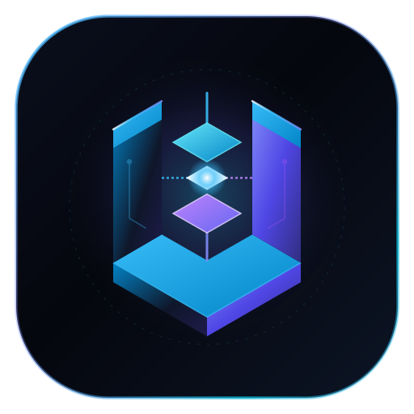

# u8u7u87 | Personal Space & Insights

<p align="center">
  
</p>

<p align="center">
  <b>探索软件工程、大模型基础设施（AI Infra）、分布式架构与行业深度洞察的个人知识空间</b>
</p>

<p align="center">
  <a href="https://u8u7u87.github.io/personal-website/"></a>
  
  
</p>

---

## 🌐 在线一键直达

> **🔗 网站访问链接**：[**https://u8u7u87.github.io/personal-website/**](https://u8u7u87.github.io/personal-website/)  
> *(推荐添加到浏览器书签收藏，随时查阅)*

---

## 📖 站点内容与架构全景

本站基于 **VitePress** 与深度定制的**暗色玻璃拟态（Cyber Slate Glassmorphism）**设计系统打造，核心分为四大模块：

```
personal-website/
├── 📌 /llm/        AI Infra 6层全景拓扑、分布式并行、编译器、Serving 与算子实战
├── 📊 /analysis/   科技与 AI 头部企业深度研报（DeepSeek、智谱、月之暗面等）
├── 📚 /books/      AI Engineering 学习成长手册（Prompt、RAG、Agent、微调与后训练）
└── ✍️ /blog/       系统架构、技术演进、阅读思考与工程随笔
```

### 1. 🖥️ LLM & AI Infra 全景总览 (`/llm/`)
系统化拆解现代 AI 大模型基础设施技术栈：
- **Layer 0: 物理硬件与算力** —— GPU 架构、HBM 显存带宽、Roofline 模型、Tensor Core 与高速互联拓扑。
- **Layer 1: 分布式并行与编译器** —— 3D 并行（TP/PP/DP）、FlashAttention、IR 与 Pass 优化、算子融合、OpenAI Triton 实战与 ZeRO 通信重叠。
- **Layer 2: 模型架构与 Serving 引擎** —— 注意力机制演进（MHA/GQA/MLA）、RoPE 位置编码、MoE 架构、SFT/RLHF/DPO/GRPO (DeepSeek R1)、推理引擎演进（vLLM/SGLang/TRT-LLM）。
- **Layer 3: 集群调度与虚拟化** —— GPU 资源调度（Slurm/Kueue/Ray）、混部与 MIG/vGPU 隔离。
- **Layer 4: 运维与可靠性** —— 全链路 Token 追踪、千卡故障自动恢复与熔断降级。
- **Layer 5: 应用与智能体架构** —— ReAct/Reflexion 模式、记忆机制与函数调用、Hybrid Search / GraphRAG 实践。
- **Layer 6: 高频面试题与手撕代码** —— RMSNorm/AdamW、PagedAttention、GQA、分布式排障实战。

### 2. 📊 头部企业深度研报 (`/analysis/`)
深度跟踪与拆解国内外 AI 与前沿科技公司商业与技术路线：
- **AI 前沿独角兽**：DeepSeek（深度求索）、Moonshot AI（月之暗面）、Zhipu AI（智谱 AI）、MiniMax、Baichuan AI（百川智能）、StepFun（阶跃星辰）、01.AI（零一万物）。
- **互联网与硬件大厂**：美团、腾讯、阿里巴巴、字节跳动、华为、小米、网易等。

### 3. 📚 AI Engineering 学习成长手册 (`/books/`)
面向大模型应用与系统工程的全阶落地指引：
- 第一章：大模型基础与 API 核心开发
- 第二章：提示词工程与系统设计
- 第三章：RAG (检索增强生成) 架构与生产级实践
- 第四章：Agent (智能体) 系统的构建与评估
- 第五章：模型微调与大模型后训练
- 第六章：AI 产品部署、监控与成本优化
- 第七章：前沿探索与终身学习指南

### 4. ✍️ 博客与思考随笔 (`/blog/`)
按标签聚合的技术思考、架构心得与行业复盘。

---

## 🛠️ 本地开发与运行指南

### 环境依赖
- **Node.js** >= 18.0.0
- **npm** >= 9.0.0

### 操作步骤

```bash
# 1. 切换至网站目录
cd personal-website

# 2. 安装项目依赖
npm install

# 3. 启动本地实时热重载开发服务器
npm run dev

# 4. 构建生产打包产物
npm run build

# 5. 本地预览生产构建产物
npm run preview
```

本地服务启动后，默认可通过 `http://localhost:5173/personal-website/` 进行本地实时调试。

---

## 🚀 自动部署工作流（CI/CD）

站点配置了基于 **GitHub Actions** 的全自动部署流程（`.github/workflows/deploy.yml`）：
1. 每次向 `main` 分支执行 `git push` 时自动触发。
2. 容器环境自动安装依赖并执行 `npm run build` 静态打包。
3. 构建产物自动发布至 **GitHub Pages**。
4. 全程自动化，约 40-50 秒即可在线生效。

---

<p align="center">
  <b>© 2026 u8u7u87 · Built with VitePress & Antigravity</b>
</p>
